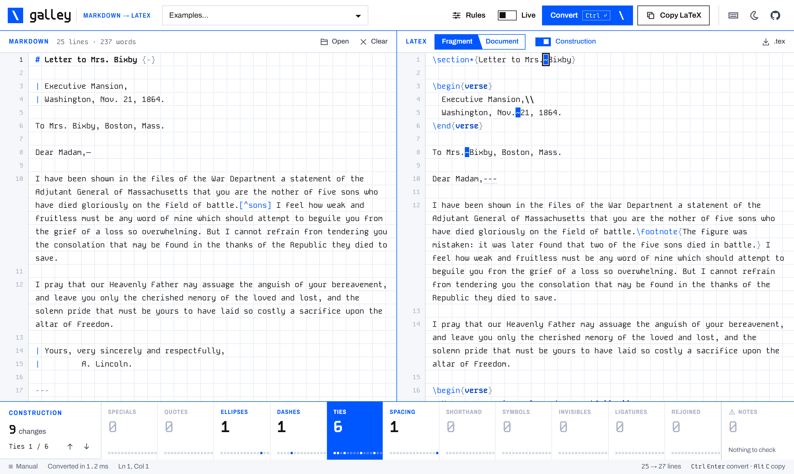

<p align="center"></p>

# Galley

Markdown in, LaTeX that compiles. Galley turns everyday Markdown into clean LaTeX (`\textit`, `\textbf`, `\section`, `enumerate`, tables, blockquotes, verse, footnotes) and sets the small things a typesetter would: ellipses, quotes, dashes, the spacing after abbreviations, and every special character that breaks a LaTeX run after a copy-paste.

**[Open Galley →](https://fzn0x.github.io/galley/)**



It's a two-panel writing tool. Draft or paste Markdown on the left, press Convert (or switch Live on), and copy LaTeX from the right. Turn on **Construction** and the output shows its working: every character Galley escaped, tied, quoted or cleaned up is marked, and the band underneath counts each kind of change and steps you through them. Archival editors can check that only the markup changed. Everything runs in your browser; nothing you paste leaves the page.

In letterpress, the galley is the tray that holds type once it has been set. The backslash in the logo is LaTeX's.

## Features

- **The structures you write.** `*italic*` → `\textit`, `**bold**` → `\textbf`, headings → `\section`…`\subparagraph` (or start at `\chapter` or `\part`), ordered and unordered lists → `enumerate` / `itemize` with nesting and start numbers, task lists, definition lists → `description`, pipe tables → `tabular` with booktabs rules and captions, blockquotes → `quote` / `quotation` with attribution lines, footnotes → `\footnote` at the point of reference, links → `\href` / `\url`, images → `figure`, code → `verbatim` or `listings`, `---` → a scene break.
- **Verse wrappers.** A `::: verse` block, a ```` ```verse ```` fence or Pandoc line blocks (`| `) become `\begin{verse}` with `\\` line ends, stanza breaks and indentation kept.
- **Long-form and archival defaults.** `...`, `. . .` and `…` all become `\ldots{}`. Straight and curly quotes become TeX quotes or `\enquote`. `—` and `–` become `---` and `--`, and `1847-50` becomes `1847--50`. Shorthand is normalised: `Mr.~Darcy`, `p.~12`, `pp.~12--14`, `ca.~1850`, `J.~R.~R.~Tolkien`, `Wm.~Smith`, `e.g.\ this`, `BBC\@.`, and `e. g.` becomes `e.g.`.
- **Copy-paste you can trust.** `% & $ # _ { } ~ ^ \ < > |` are always escaped. Soft hyphens, zero-width spaces and byte-order marks are removed, no-break spaces become `~`, and PDF ligatures (fi, fl) are unpacked. Symbols such as `§ ° £ ½ ©` become commands that work in any engine. Brackets after `\\` and `\item` are guarded so `[sic]` never turns into an optional argument. Optionally, words hyphenated across line ends are rejoined.
- **Construction view.** Every change is logged with its source line. Toggle Construction to see them marked in the output, pick a kind (Specials, Quotes, Ellipses, Ties…) to isolate it, and step through each occurrence. The dot strip in each cell shows where in the document that kind of change happened.
- **Linked panes.** Move the caret in the Markdown and the LaTeX it produced lights up (and scrolls into view). Point at the LaTeX and its Markdown source lights up.
- **Fragment or full document.** By default you get a body fragment to paste into an existing document, plus a strip listing the `\usepackage` lines it needs. Switch to Document for a compilable file whose preamble loads only those packages, with `title`, `author`, `date`, `abstract` and `lang` taken from YAML front matter.
- **LaTeX passes through.** `$math$`, `$$display$$`, `\cite{…}`, `\ref{…}`, `\begin{equation}…` blocks and ```` ```{=latex} ```` fences go through untouched. Pandoc citations (`[@knuth84, p. 12]`) become `\cite[p.~12]{knuth84}`. Headings take `{#label}` and `{-}`.
- **Notes before you compile.** Undefined footnotes, characters pdfLaTeX cannot set (Greek, Cyrillic, CJK, emoji), environments that need defining, lists nested too deep.
- **Rules you can change.** Top-level heading, numbering, scene break, table style, code style, `\textit` or `\emph`, quote style, ellipsis command, dashes, shorthand, invisibles, line breaks (join, or keep every line for letters), Unicode handling (symbols, ASCII-only for older pdfLaTeX, or keep everything for XeLaTeX/LuaLaTeX), raw LaTeX, document class.
- Convert and Copy, an optional Live mode, keyboard shortcuts, file open, drag and drop, `.tex` download, day and night themes, and a layout that works on phones.

### Keyboard shortcuts

| Keys | Action |
| --- | --- |
| <kbd>Ctrl</kbd> <kbd>Enter</kbd> (<kbd>⌘</kbd> <kbd>Enter</kbd>) | Convert |
| <kbd>Alt</kbd> <kbd>C</kbd> | Copy the LaTeX |
| <kbd>Alt</kbd> <kbd>L</kbd> | Live conversion on or off |
| <kbd>Alt</kbd> <kbd>M</kbd> | Construction view on or off |
| <kbd>Alt</kbd> <kbd>D</kbd> | Fragment or full document |
| <kbd>Alt</kbd> <kbd>N</kbd> / <kbd>Alt</kbd> <kbd>Shift</kbd> <kbd>N</kbd> | Next / previous change of the selected kind |
| <kbd>Ctrl</kbd> <kbd>S</kbd> / <kbd>Ctrl</kbd> <kbd>O</kbd> | Download `.tex` / open a Markdown file |
| <kbd>Tab</kbd> / <kbd>Shift</kbd> <kbd>Tab</kbd> | Indent / outdent lines in the editor (<kbd>Esc</kbd> then <kbd>Tab</kbd> moves focus on) |
| <kbd>?</kbd> | Show the shortcuts |

## Example

```markdown
## Editorial note {-}

The text follows the *Boston Evening Transcript*, Nov. 25, 1864, p. 2.
Historians debate whether Lincoln or John Hay wrote it... the question is open.[^1]

> Transcription is an act of interpretation.
>
> — the project style guide

[^1]: Later facsimiles are reproductions, i.e. not the original.
```

becomes

```latex
\subsection*{Editorial note}

The text follows the \textit{Boston Evening Transcript}, Nov.~25, 1864, p.~2.
Historians debate whether Lincoln or John Hay wrote it\ldots{} the question is open.\footnote{Later facsimiles are reproductions, i.e.\ not the original.}

\begin{quote}
  Transcription is an act of interpretation.

  \hspace*{\fill}--- the project style guide
\end{quote}
```

## Syntax at a glance

| Markdown | LaTeX |
| --- | --- |
| `# Title`, `## Section {#sec:x}`, `# Preface {-}` | `\section{Title}`, `\subsection{Section}\label{sec:x}`, `\section*{Preface}` |
| `*it*`, `**bold**`, `~~struck~~`, `` `code` `` | `\textit{it}`, `\textbf{bold}`, `\sout{struck}`, `\texttt{code}` |
| `19^th^`, `H~2~O`, `[Smith]{.smallcaps}` | `19\textsuperscript{th}`, `H\textsubscript{2}O`, `\textsc{Smith}` |
| `1.` / `-` / `- [x]` lists, `Term` + `: def` | `enumerate` / `itemize` / `\item[$\boxtimes$]`, `description` |
| `> quote`, `> — Author` | `quote` or `quotation`, `\hspace*{\fill}--- Author` |
| `::: verse`, ```` ```verse ````, `\| line` | `\begin{verse}` … `\end{verse}` |
| `::: center` (any name) | `\begin{center}` … `\end{center}` |
| Pipe table + `Table: Caption {#tbl:x}` | `table` + `tabular` (booktabs) + `\caption` + `\label` |
| `[^1]` + `[^1]: text`, `^[inline]` | `\footnote{text}` |
| `[text](url)`, `<url>`, bare URLs | `\href{url}{text}`, `\url{url}` |
| `{width=50%}` | `figure` + `\includegraphics[width=0.5\linewidth]` |
| `$x$`, `$$x$$`, `\cite{k}`, `[@k, p. 4]` | `$x$`, `\[x\]`, `\cite{k}`, `\cite[p.~4]{k}` |
| `---`, `<!-- pagebreak -->`, `<!-- note -->` | scene break, `\newpage`, `% note` |

## Run it locally

There is no build step and there are no dependencies. Clone the repository and open `index.html` in a browser:

```sh
git clone https://github.com/fzn0x/galley.git
cd galley
# open index.html, or serve the folder:
python -m http.server 8000   # then visit http://localhost:8000
```

Any static host works the same way: GitHub Pages, Netlify, Vercel, or an S3 bucket.

## Use the engine elsewhere

`js/galley.js` has no DOM access and works in Node as well as the browser:

```js
const Galley = require('./js/galley.js');

const { latex, changes, packages, warnings } = Galley.convert('Mr. Darcy said "Hello..."', {
  quotes: 'csquotes',
  document: false,
});
// latex    → 'Mr.~Darcy said \\enquote{Hello\\ldots{}}\n'
// packages → [{ name: 'csquotes', options: '', why: 'quotations' }]
```

See `Galley.DEFAULTS` for every option.

## Development

```sh
npm test      # or: node --test tests/galley.test.js   (Node 20+)
```

| Path | What it holds |
| --- | --- |
| `index.html` | The page: markup, icon sprite, and the Content-Security-Policy |
| `js/galley.js` | The interpreter: block and inline parsing, normalisation, the change log and source map. Tested directly in Node |
| `js/app.js` | The UI: editor, output, Construction view, band, rules, files, shortcuts, themes |
| `js/examples.js` | The example roster (public domain or synthetic texts) |
| `css/styles.css` | Tokens, components, themes and responsive rules |
| `css/fonts.css` | Font faces, with the Latin subsets embedded so the page renders from `file://` |
| `assets/` | The logo and mark as SVG |
| `tests/` | Engine tests, using Node's built-in test runner |
| `DESIGN.md` | The design system (palette, type, components, rules) |

The scripts are plain classic scripts, not ES modules, so the page keeps working when you open it straight from disk.

## Contributing

Bug reports, ideas and pull requests are welcome. Please read [CONTRIBUTING.md](CONTRIBUTING.md) first. To report a security problem, follow [SECURITY.md](SECURITY.md) rather than opening a public issue.

## Privacy

Galley makes no network requests. Parsing, converting, file opening and downloads all happen inside the page. The only things it stores are your last input and settings, in your browser's `localStorage`.

## License

[MIT](LICENSE) © fzn0x

Bundled fonts: [Archivo](https://github.com/Omnibus-Type/Archivo) and [Kode Mono](https://github.com/isaozler/kode-mono), both under the [SIL Open Font License 1.1](fonts/). The example texts are in the public domain (Lincoln, 1864; Shakespeare, 1609; Dickinson, 1891) or synthetic.
